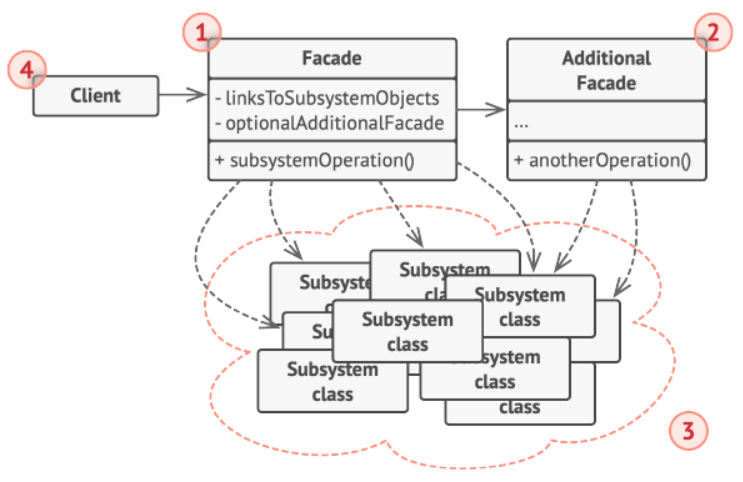
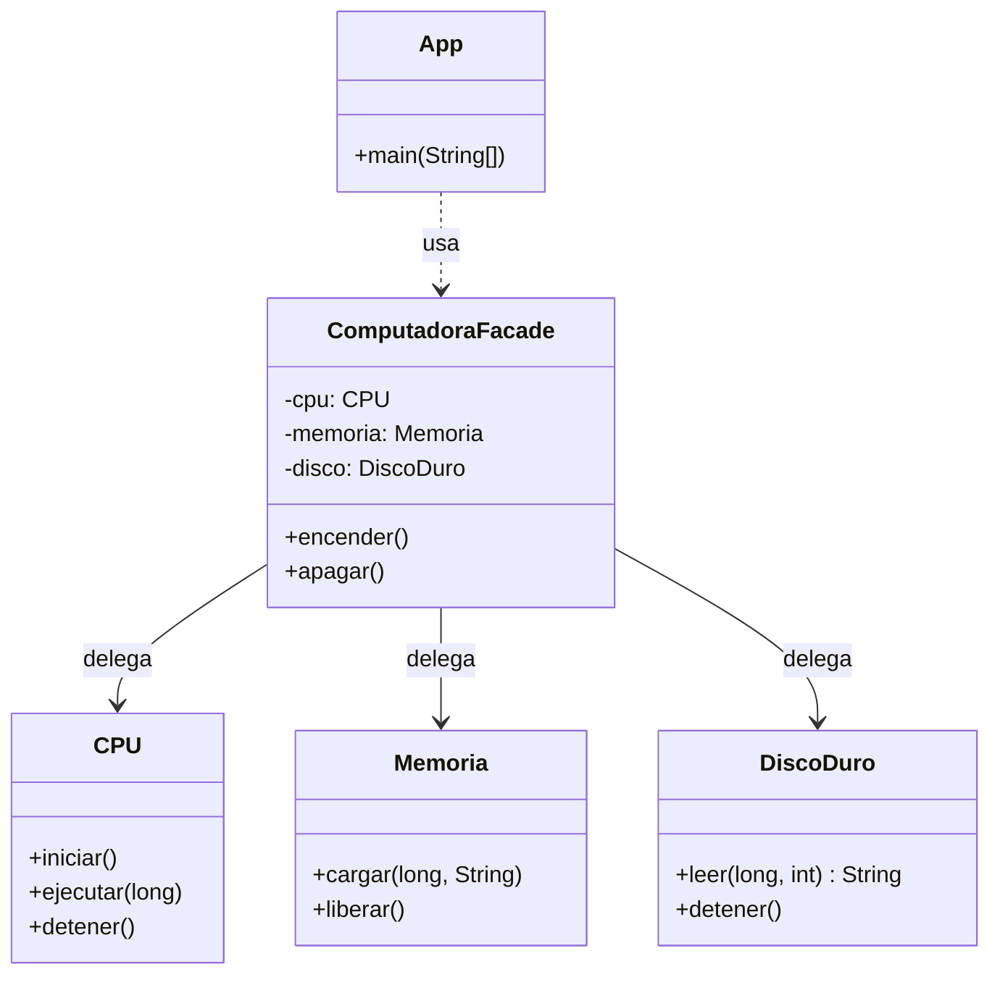

# Facade (Fachada)

## ¿Qué es Facade?

Facade es un patrón de diseño **estructural** cuyo propósito principal es **proporcionar una interfaz unificada y simplificada a un conjunto de interfaces de un subsistema complejo**. La fachada define una interfaz de más alto nivel que hace que el subsistema sea más fácil de usar.

En lugar de obligar al cliente a conocer, instanciar y coordinar múltiples clases internas, este patrón concentra esa coordinación en una única clase intermediaria. El cliente se comunica con la fachada, y es la fachada quien delega el trabajo en los componentes correctos y en el orden correcto.

El patrón se enfoca en **reducir el acoplamiento entre el cliente y el subsistema**: el cliente deja de depender de muchas clases concretas y pasa a depender de una sola.

---

## Estructura general



**Descripción de los componentes de la arquitectura:**

1. **Las clases del Subsistema (*Subsystem Classes*):** Implementan la funcionalidad real del sistema. Cada una resuelve una responsabilidad concreta y **no tiene conocimiento de la fachada**: no guardan ninguna referencia hacia ella. Pueden ser usadas directamente si se desea.
2. **La Fachada (*Facade*):** Conoce qué clases del subsistema son responsables de cada petición y en qué orden deben invocarse. Expone un conjunto reducido de métodos de alto nivel y delega internamente el trabajo en los objetos del subsistema.
3. **El Cliente:** Utiliza la fachada en lugar de invocar directamente los objetos del subsistema. Solo conoce la interfaz simplificada.

---

## El problema

Considérese un sistema donde un cliente necesita utilizar una funcionalidad que depende de **varias clases colaborando en un orden específico**. Por ejemplo, encender una computadora requiere coordinar tres componentes: el procesador (`CPU`), la memoria (`Memoria`) y el disco duro (`DiscoDuro`).

Si el cliente interactúa directamente con cada uno de ellos, el código resultante luce así:

```java
// Ejemplo del problema: el cliente maneja el subsistema directamente
CPU cpu = new CPU();
Memoria memoria = new Memoria();
DiscoDuro disco = new DiscoDuro();

cpu.iniciar();
String datos = disco.leer(0, 1024);
memoria.cargar(0, datos);
cpu.ejecutar(0);
```

Esta aproximación genera varios problemas arquitectónicos:

**Problema 1: Alto acoplamiento.**
El cliente depende de tres clases concretas. Si alguna cambia su interfaz, o si se agrega un nuevo componente al proceso, **todos los clientes** que usan este código deben modificarse.

**Problema 2: Conocimiento excesivo del cliente.**
El cliente debe saber *cómo* funciona el subsistema: qué clases existen, qué métodos tienen, qué parámetros reciben y, sobre todo, **en qué orden deben llamarse**. Un orden incorrecto (por ejemplo, ejecutar el CPU antes de cargar la memoria) produce errores difíciles de detectar.

**Problema 3: Duplicación de código.**
Si varios clientes necesitan encender la computadora, cada uno repite la misma secuencia de pasos. Cualquier corrección debe replicarse en todos los lugares.

---

## La solución

El patrón Facade propone **crear una clase intermediaria que encapsule la complejidad del subsistema** y exponga únicamente las operaciones que el cliente realmente necesita.

- La clase **`ComputadoraFacade`** asume el rol de **fachada**. Mantiene referencias privadas a `CPU`, `Memoria` y `DiscoDuro`, conoce la secuencia exacta de llamadas y la expone a través de métodos simples como `encender()` y `apagar()`.
- Las clases **`CPU`**, **`Memoria`** y **`DiscoDuro`** conservan su lógica sin ninguna modificación. No saben que existe una fachada.
- El **cliente** solo interactúa con `ComputadoraFacade`.

Como resultado:

- El cliente reduce su interacción a **una sola llamada** (`encender()`), sin importar cuántos pasos internos existan.
- La secuencia correcta se define **en un único lugar**, eliminando duplicación y errores de orden.
- Los cambios internos del subsistema se absorben en la fachada sin afectar a los clientes.

---

## Estructura de la solución



---

## Código para probar

### Clases del subsistema: CPU, Memoria y DiscoDuro

Estas clases representan la funcionalidad real. Cada una tiene una responsabilidad concreta y **no conoce a la fachada**.

```java
// CPU.java
// SUBSISTEMA: clase con su propia lógica interna.
// El cliente NO debería tener que conocer cómo ni cuándo se usa.
public class CPU {

    public void iniciar() {
        System.out.println("CPU: iniciando procesador...");
    }

    public void ejecutar(long direccion) {
        System.out.println("CPU: ejecutando instrucciones desde la dirección " + direccion);
    }

    public void detener() {
        System.out.println("CPU: deteniendo procesador...");
    }
}
```

```java
// Memoria.java
// SUBSISTEMA: administra la carga y liberación de datos.
public class Memoria {

    public void cargar(long direccion, String datos) {
        System.out.println("Memoria: cargando '" + datos + "' en la dirección " + direccion);
    }

    public void liberar() {
        System.out.println("Memoria: liberando memoria...");
    }
}
```

```java
// DiscoDuro.java
// SUBSISTEMA: lee los datos almacenados.
public class DiscoDuro {

    public String leer(long sector, int tamano) {
        System.out.println("Disco: leyendo " + tamano + " bytes desde el sector " + sector);
        return "Sistema Operativo";
    }

    public void detener() {
        System.out.println("Disco: deteniendo discos...");
    }
}
```

### Clase Fachada: ComputadoraFacade

```java
// ComputadoraFacade.java
// FACHADA: punto de acceso único al subsistema.
// Oculta al cliente qué clases existen y en qué orden deben usarse.
public class ComputadoraFacade {

    // Valores de arranque que solo la fachada necesita conocer
    private static final long DIRECCION_ARRANQUE = 0;
    private static final long SECTOR_ARRANQUE = 0;
    private static final int TAMANO_ARRANQUE = 1024;

    // REFERENCIAS AL SUBSISTEMA: privadas, el cliente no accede a ellas
    private CPU cpu;
    private Memoria memoria;
    private DiscoDuro disco;

    // La fachada crea y administra los objetos del subsistema
    public ComputadoraFacade() {
        this.cpu = new CPU();
        this.memoria = new Memoria();
        this.disco = new DiscoDuro();
    }

    // MÉTODO DE ALTO NIVEL: una sola llamada para el cliente.
    // Aquí vive la secuencia correcta de pasos (el orden importa).
    public void encender() {
        cpu.iniciar();
        String datos = disco.leer(SECTOR_ARRANQUE, TAMANO_ARRANQUE);
        memoria.cargar(DIRECCION_ARRANQUE, datos);
        cpu.ejecutar(DIRECCION_ARRANQUE);
    }

    // MÉTODO DE ALTO NIVEL: oculta la secuencia de apagado.
    public void apagar() {
        cpu.detener();
        memoria.liberar();
        disco.detener();
    }
}
```

### Cliente: App.java

```java
// App.java
// CLIENTE: solo conoce la fachada.
// No importa ni instancia CPU, Memoria ni DiscoDuro.
public class App {
    public static void main(String[] args) {
        ComputadoraFacade computadora = new ComputadoraFacade();

        System.out.println("=== Encendiendo la computadora ===");
        computadora.encender(); // una sola llamada, múltiples pasos internos

        System.out.println();

        System.out.println("=== Apagando la computadora ===");
        computadora.apagar();
    }
}
```

Salida esperada:

```
=== Encendiendo la computadora ===
CPU: iniciando procesador...
Disco: leyendo 1024 bytes desde el sector 0
Memoria: cargando 'Sistema Operativo' en la dirección 0
CPU: ejecutando instrucciones desde la dirección 0

=== Apagando la computadora ===
CPU: deteniendo procesador...
Memoria: liberando memoria...
Disco: deteniendo discos...
```

### Relación entre el modelo y el ejemplo

El código anterior es una ejemplificación del patrón. La siguiente tabla indica qué rol del modelo cumple cada clase del ejemplo:

| Rol en el modelo | Clase en el ejemplo | Responsabilidad en el ejemplo |
|---|---|---|
| **Subsistema** | `CPU` | Iniciar, ejecutar instrucciones y detener el procesador. |
| **Subsistema** | `Memoria` | Cargar datos en una dirección y liberarlos. |
| **Subsistema** | `DiscoDuro` | Leer datos desde un sector y detener los discos. |
| **Fachada** | `ComputadoraFacade` | Coordinar los tres componentes en el orden correcto y exponer `encender()` y `apagar()`. |
| **Cliente** | `App` | Encender y apagar la computadora sin conocer los componentes internos. |

Como se evidencia en la ejecución, el cliente realiza **una sola llamada** (`encender()`), mientras que internamente se ejecutan **cuatro pasos coordinados** sobre tres objetos distintos. Las clases `CPU`, `Memoria` y `DiscoDuro` no fueron modificadas ni saben que existe la fachada: toda la coordinación reside exclusivamente en `ComputadoraFacade`. Esto se corresponde con el modelo: la fachada simplifica el acceso al subsistema sin alterarlo.

---

## Acceso directo al subsistema y múltiples fachadas

Una característica importante del patrón es que **la fachada no reemplaza ni bloquea al subsistema**: solo ofrece un camino más sencillo hacia él. Esto da lugar a dos consideraciones de diseño.

**1. El cliente puede seguir usando el subsistema directamente.**
En el ejemplo, `CPU`, `Memoria` y `DiscoDuro` son clases públicas. Un cliente con necesidades avanzadas (por ejemplo, leer un sector específico del disco sin encender toda la computadora) puede instanciarlas y usarlas por su cuenta, saltándose la fachada. Así, la fachada cubre los casos comunes y el subsistema sigue disponible para los casos especiales.

Si, por el contrario, se desea **forzar** que todos los clientes pasen por la fachada, se puede declarar las clases del subsistema con visibilidad de paquete (sin el modificador `public`) y ubicarlas en el mismo paquete que la fachada. De ese modo, solo la fachada puede instanciarlas.

**2. Se pueden crear múltiples fachadas.**
Cuando una única fachada crece demasiado y acumula responsabilidades no relacionadas, se puede dividir en varias fachadas más pequeñas, cada una enfocada en una tarea. En el ejemplo, se podría tener `ArranqueFacade` (para encender y apagar) y `MantenimientoFacade` (para diagnósticos y respaldos), ambas sobre el mismo subsistema. Incluso una fachada puede apoyarse en otra, siempre manteniendo cada una acotada a un propósito claro.

---

## Cuándo usarlo y cuándo no

**Aplicabilidad (Cuándo usarlo):**

- Cuando se necesita una interfaz simple y limitada hacia un subsistema complejo, de modo que los casos de uso más comunes se resuelvan con pocas llamadas.
- Cuando existen muchas dependencias entre el cliente y las clases concretas de un subsistema, y se desea reducir ese acoplamiento.
- Cuando se quiere organizar un sistema en capas, usando una fachada como punto de entrada a cada nivel.
- Cuando el uso de un subsistema exige conocer una secuencia de pasos que se repite en varios lugares del código.

**Contraindicaciones (Cuándo evitarlo):**

- Cuando el subsistema es simple y el cliente ya lo usa con facilidad: la fachada solo añadiría una capa innecesaria.
- Cuando los clientes requieren control fino sobre cada componente en todos los casos, ya que una interfaz simplificada resultaría limitante.
- Cuando la fachada tiende a acumular demasiadas responsabilidades y se convierte en un objeto que lo sabe y lo hace todo (*God Object*); en ese caso conviene dividirla en varias fachadas.

---

## Resumen

| Dimensión | Patrón Facade |
|---|---|
| **Clasificación** | Estructural |
| **Problema que resuelve** | Complejidad y alto acoplamiento entre un cliente y múltiples clases de un subsistema que deben coordinarse en un orden específico. |
| **Implementación en Java** | Una clase fachada que mantiene referencias privadas a los objetos del subsistema y expone métodos de alto nivel que delegan y coordinan las llamadas. Las clases del subsistema no se modifican. |
| **Ventajas** | Simplifica el uso del subsistema; reduce el acoplamiento entre cliente y subsistema; centraliza la secuencia de pasos eliminando duplicación; permite cambiar el subsistema internamente sin afectar a los clientes. |
| **Desventajas** | La fachada puede convertirse en un objeto con demasiadas responsabilidades si no se controla su alcance; añade una capa adicional de indirección. |
